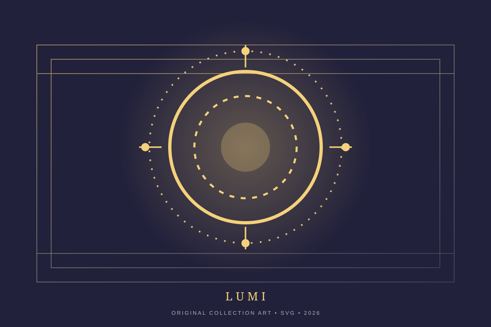

# Creative Collection — SVG Gallery

Original repository emblems. Each preview is rendered from its source SVG; open the source link to inspect the editable vector.

| Collection | Rendered artwork | Source |
|---|---|---|
| ERIA — Lantern of Lineage |  | [SVG source](https://github.com/Vanellye/CodEXgen/blob/main/collections/art/collection-emblem.svg) |
| ASH — Orchard of Small Truths |  | [SVG source](https://github.com/Vanellye/Ash/blob/main/collections/art/collection-emblem.svg) |
| GLYPH — Glyph Garden |  | [SVG source](https://github.com/Vanellye/Y-/blob/main/collections/art/collection-emblem.svg) |
| LUMI — Returning Light |  | [SVG source](https://github.com/vanellyetm-ux/Lumi/blob/main/collections/art/collection-emblem.svg) |
| RECORD — Cabinet of Living Records |  | [SVG source](https://github.com/vanellyetm-ux/Ash/blob/main/collections/art/collection-emblem.svg) |
| OPEN — Open Shelf Reading Room |  | [SVG source](https://github.com/vanellyetm-ux/-/blob/main/collections/art/collection-emblem.svg) |
| SCOPE — Permission Garden |  | [SVG source](https://github.com/vanellyetm-ux/write-access/blob/main/collections/art/collection-emblem.svg) |
| THREAD — Thread Mirror Return |  | [SVG source](https://github.com/vanellyetm-ux/-ilk--mirror/blob/main/collections/art/collection-emblem.svg) |

## Rendering notes

- Artwork remains vector SVG; GitHub renders the source directly without rasterizing it.
- The source files include accessible title and description metadata.
- This gallery covers public repositories only. Private-repository artwork remains in its original private repository and is not exposed here.
- These are visual collection emblems, not verified scientific or measurement diagrams.
